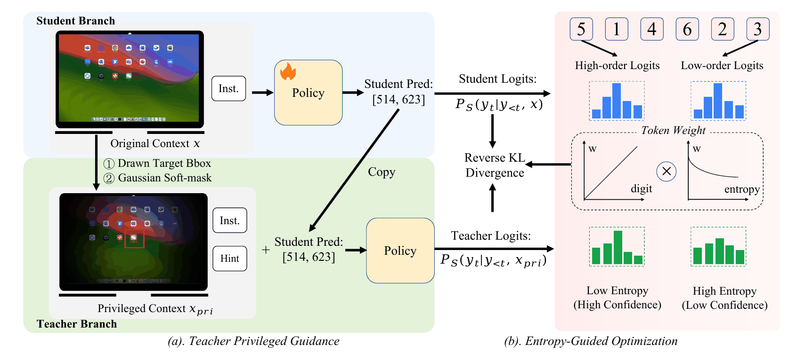

<div align="center">

# Screenshot Grounding Toolkit

### Tools for training screenshot-to-coordinate models

**Data preparation | Model training | Evaluation**

<p align="right"><a href="README.zh-CN.md"></a><a href="README.md"></a></p>

<p><a href="#quick-start">Quick start</a> | <a href="#data-preparation">Data</a> | <a href="#training">Training</a> | <a href="#evaluation">Evaluation</a></p>



</div>

This repository contains the commands, configurations, and tests for preparing screenshot datasets, training coordinate-prediction models, and evaluating their outputs.

## Project Contents

| Area | Entry point | Purpose |
|---|---|---|
| Data | `vpopsd.prepare` | Convert records and create reproducible splits |
| Training | `vpopsd.train` | Fine-tune with LoRA or full model weights |
| Evaluation | `vpopsd.evaluate`, `vpopsd.suite` | Score predictions and run benchmark suites |
| Settings | `configs/` | Training, inference, and benchmark configuration |

## Quick Start

Generate a sample, then evaluate its coordinate prediction:

```bash
python -m vpopsd.demo
python -m vpopsd.evaluate --data outputs/demo/examples.jsonl --predictions outputs/demo/predictions.jsonl --output-dir outputs/demo/eval
```

## Installation

Use Python 3.12 and a CUDA GPU for training. Install compatible PyTorch and torchvision builds using the [PyTorch installation guide](https://pytorch.org/get-started/locally/).

```bash
git clone https://github.com/tjucrush/visual-privileged-opsd-main.git
cd visual-privileged-opsd-main
python -m venv .venv
source .venv/bin/activate
# Install torch 2.6-2.8 and a matching torchvision build for your CUDA version.
pip install -e '.[dev,data]'
```

On Windows, activate the environment with `.venv\Scripts\Activate.ps1`. The project uses Transformers 4.57.1. Training runs in a single process on one device.

## Data Preparation

Each JSONL record contains an instruction, screenshot, and bounding box. Coordinates use **normalized xyxy values in [0,1]**. Relative image paths resolve from the JSONL directory.

```json
{"id":"sample-1","image":"images/1.png","instruction":"Click Save","bbox":[0.65,0.62,0.825,0.73],"benchmark":"scalecua"}
```

Obtain GUI grounding data from [ScaleCUA](https://github.com/OpenGVLab/ScaleCUA), then map its fields and coordinate format to the canonical schema:

```bash
python -m vpopsd.prepare convert --input data/raw/grounding.jsonl --image-root data/raw/images --image-field image --instruction-field instruction --bbox-field bbox --bbox-format xyxy --bbox-units pixels --output data/scalecua/all.jsonl
python -m vpopsd.prepare split --input data/scalecua/all.jsonl --train-size 7000 --val-size 300 --seed 42 --output-dir data/scalecua
```

Adjust field names and bounding-box units to match the source files. Nested fields use dot notation. Splitting groups records by decoded screenshot content to keep training and validation images disjoint. Add `--exclude path/to/benchmark.jsonl ...` to exclude evaluation screenshots. Split metadata records the seed and source SHA256.

## Training

```bash
python -m vpopsd.train --config configs/qwen3_vl_8b.yaml
```

The default configuration uses LoRA rank 16, AdamW, one epoch, and gradient accumulation of 8. Set `lora: false` for full fine-tuning. Use a separate `output_dir` for each run.

Outputs include configuration and package versions, dataset metadata, token validity, reverse KL, teacher entropy, token weights, training time, and model weights. Training time covers rollouts, teacher and student passes, backpropagation, and optimizer updates.

## Evaluation

```bash
python -m vpopsd.evaluate --data data/benchmarks/screenspot/test.jsonl --config configs/eval_base.yaml --output-dir outputs/eval-base
python -m vpopsd.suite --suite configs/benchmarks.yaml --config configs/eval_base.yaml --output-dir outputs/suite-base
```

To evaluate a LoRA checkpoint, set `adapter: outputs/vpopsd-qwen3-vl-8b/model` in the inference configuration. For a fully fine-tuned checkpoint, set `model_name` to the saved model directory.

The suite covers ScreenSpot, ScreenSpot-v2, ScreenSpot-Pro, GroundUI-1K, OSWorld-G bounding-box tasks, and UI-Vision element grounding. See [Benchmark Preparation](docs/benchmarks.md) for adapters and task definitions.

Evaluation uses original screenshots and point-in-box accuracy. Reports include per-dataset accuracy, equal-weight macro accuracy, and sample-weighted micro accuracy. Missing or malformed predictions count as failures. Run outputs are saved in `metrics.json`, `predictions.jsonl`, and `details.jsonl`.

## Ablations

| Ablation | Configuration |
|---|---|
| Disable digit importance | `position_weighting: false` |
| Disable entropy weighting | `entropy_weighting: false` |
| Disable red boxes | `privilege.red_box: false` |
| Disable Gaussian masks | `privilege.gaussian_mask: false` |
| Disable teacher privilege | Set red boxes, Gaussian masks, and `teacher_hint` to false |

## Tests

```bash
pytest -q
ruff check .
```

The 24 tests cover reverse KL, teacher gradient isolation, token alignment, coordinate conventions, image-disjoint splits, evaluation metrics, and a tiny Qwen3-VL integration with image inputs, generation, LoRA, and backpropagation. See [Validation](docs/validation.md) for the tested environment.

## Project Structure

```text
src/vpopsd/     Training, evaluation, model objectives, and dataset utilities
configs/       Training, inference, and benchmark suite configurations
tests/         Objective, alignment, data, and model integration tests
docs/          Method details, benchmark preparation, and validation
```

## References

- [Qwen3-VL-8B-Instruct](https://huggingface.co/Qwen/Qwen3-VL-8B-Instruct)
- [Transformers Qwen3-VL API](https://huggingface.co/docs/transformers/model_doc/qwen3_vl)
- [ScaleCUA](https://github.com/OpenGVLab/ScaleCUA)

## License

Code is released under the [MIT License](LICENSE). Models and datasets follow their respective upstream licenses.
