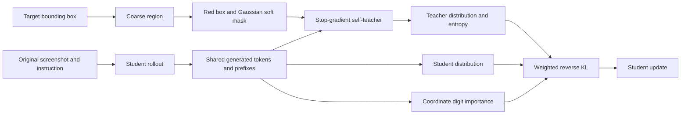
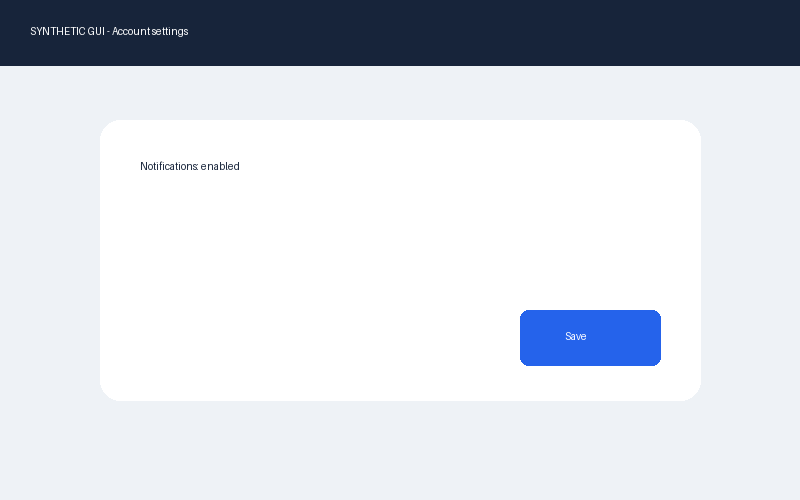
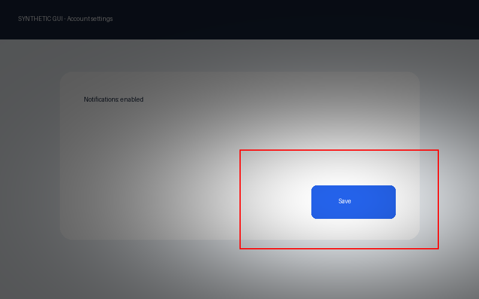

# Visual-Privileged OPSD for GUI Grounding

On-policy self-distillation for GUI grounding with visual teacher privilege and dynamically weighted token supervision. Built for **Qwen3-VL-8B-Instruct**.

The student generates coordinates from the original screenshot. A stop-gradient teacher branch uses the current model with a coarse red box, Gaussian soft mask, and visual guidance prompt. Training aligns both distributions on the same student-generated tokens and minimizes position- and confidence-weighted reverse KL divergence.

## Method



- **Visual privilege:** snap the target box to an expanded coarse grid, then apply a red rectangle and Gaussian soft mask. Teacher prompts use visual guidance without inserting exact target coordinates.
- **On-policy sampling:** generate fresh student trajectories and evaluate the same completion token IDs under both branches, with independent causal alignment for each prompt.
- **Reverse KL:** compute full-vocabulary `KL(p_student || p_teacher)` with temperature scaling and detached teacher probabilities.
- **Dynamic weighting:** assign stronger supervision to more significant coordinate digits and lower-entropy teacher predictions. Merged digit tokens are supported.
- **Training:** language-layer LoRA or full fine-tuning, gradient accumulation, gradient checkpointing, model saving, and per-sample metrics.

See [Method Details](docs/method.md) for equations and configuration parameters.

## Installation

Use Python 3.12 and a CUDA GPU for training. Install compatible PyTorch and torchvision builds using the [PyTorch installation guide](https://pytorch.org/get-started/locally/).

```bash
git clone https://github.com/tjucrush/visual-privileged-opsd-main.git
cd visual-privileged-opsd-main
python -m venv .venv
source .venv/bin/activate
# Install torch 2.6-2.8 and a matching torchvision build for your CUDA version.
pip install -e '.[dev,data]'
```

On Windows, activate the environment with `.venv\Scripts\Activate.ps1`. The project uses Transformers 4.57.1. Training runs in a single process on one device.

## Quick Start

Generate a synthetic GUI example and its privileged teacher view:

```bash
python -m vpopsd.demo
python -m vpopsd.evaluate --data outputs/demo/examples.jsonl --predictions outputs/demo/predictions.jsonl --output-dir outputs/demo/eval
```

| Student screenshot | Privileged teacher view |
|---|---|
|  |  |

## Data Preparation

Each JSONL record contains an instruction, screenshot, and bounding box. Coordinates use **normalized xyxy values in [0,1]**. Relative image paths resolve from the JSONL directory.

```json
{"id":"sample-1","image":"images/1.png","instruction":"Click Save","bbox":[0.65,0.62,0.825,0.73],"benchmark":"scalecua"}
```

Obtain GUI grounding data from [ScaleCUA](https://github.com/OpenGVLab/ScaleCUA), then map its fields and coordinate format to the canonical schema:

```bash
python -m vpopsd.prepare convert --input data/raw/grounding.jsonl --image-root data/raw/images --image-field image --instruction-field instruction --bbox-field bbox --bbox-format xyxy --bbox-units pixels --output data/scalecua/all.jsonl
python -m vpopsd.prepare split --input data/scalecua/all.jsonl --train-size 7000 --val-size 300 --seed 42 --output-dir data/scalecua
```

Adjust field names and bounding-box units to match the source files. Nested fields use dot notation. Splitting groups records by decoded screenshot content to keep training and validation images disjoint. Add `--exclude path/to/benchmark.jsonl ...` to exclude evaluation screenshots. Split metadata records the seed and source SHA256.

## Training

```bash
python -m vpopsd.train --config configs/qwen3_vl_8b.yaml
```

The default configuration uses LoRA rank 16, AdamW, one epoch, and gradient accumulation of 8. Set `lora: false` for full fine-tuning. Use a separate `output_dir` for each run.

Outputs include configuration and package versions, dataset metadata, token validity, reverse KL, teacher entropy, token weights, training time, and model weights. Training time covers rollouts, teacher and student passes, backpropagation, and optimizer updates.

## Evaluation

```bash
python -m vpopsd.evaluate --data data/benchmarks/screenspot/test.jsonl --config configs/eval_base.yaml --output-dir outputs/eval-base
python -m vpopsd.suite --suite configs/benchmarks.yaml --config configs/eval_base.yaml --output-dir outputs/suite-base
```

To evaluate a LoRA checkpoint, set `adapter: outputs/vpopsd-qwen3-vl-8b/model` in the inference configuration. For a fully fine-tuned checkpoint, set `model_name` to the saved model directory.

The suite covers ScreenSpot, ScreenSpot-v2, ScreenSpot-Pro, GroundUI-1K, OSWorld-G bounding-box tasks, and UI-Vision element grounding. See [Benchmark Preparation](docs/benchmarks.md) for adapters and task definitions.

Evaluation uses original screenshots and point-in-box accuracy. Reports include per-dataset accuracy, equal-weight macro accuracy, and sample-weighted micro accuracy. Missing or malformed predictions count as failures. Run outputs are saved in `metrics.json`, `predictions.jsonl`, and `details.jsonl`.

## Ablations

| Ablation | Configuration |
|---|---|
| Disable digit importance | `position_weighting: false` |
| Disable entropy weighting | `entropy_weighting: false` |
| Disable red boxes | `privilege.red_box: false` |
| Disable Gaussian masks | `privilege.gaussian_mask: false` |
| Disable teacher privilege | Set red boxes, Gaussian masks, and `teacher_hint` to false |

## Tests

```bash
pytest -q
ruff check .
```

The 24 tests cover reverse KL, teacher gradient isolation, token alignment, coordinate conventions, image-disjoint splits, evaluation metrics, and a tiny Qwen3-VL integration with image inputs, generation, LoRA, and backpropagation. See [Validation](docs/validation.md) for the tested environment.

## Project Structure

```text
src/vpopsd/     Visual privilege, distillation, training, evaluation, and data tools
configs/       Training, inference, and benchmark suite configurations
tests/         Objective, alignment, data, and model integration tests
docs/          Method details, benchmark preparation, and validation
```

## References

- [Qwen3-VL-8B-Instruct](https://huggingface.co/Qwen/Qwen3-VL-8B-Instruct)
- [Transformers Qwen3-VL API](https://huggingface.co/docs/transformers/model_doc/qwen3_vl)
- [ScaleCUA](https://github.com/OpenGVLab/ScaleCUA)

## License

Code is released under the [MIT License](LICENSE). Models and datasets follow their respective upstream licenses.
